# Sentinel Mobile

> Universal, Zero-Trust Mobile Security & Device Intelligence Suite for Android.

Sentinel Mobile is an offline-first, privacy-respecting Android security application that provides multi-vector threat detection, hardware-backed perimeter surveillance, encrypted credential storage, and emergency response tools across all Android OEM ecosystems (Samsung One UI, Google Pixel UI, OnePlus OxygenOS, Xiaomi HyperOS, Nothing OS, Motorola Hello UI, Vivo Funtouch OS, and Oppo ColorOS).


---

## Application Showcase

| Dashboard | Junk Cleaner | Security Scan |
| :---: | :---: | :---: |
| 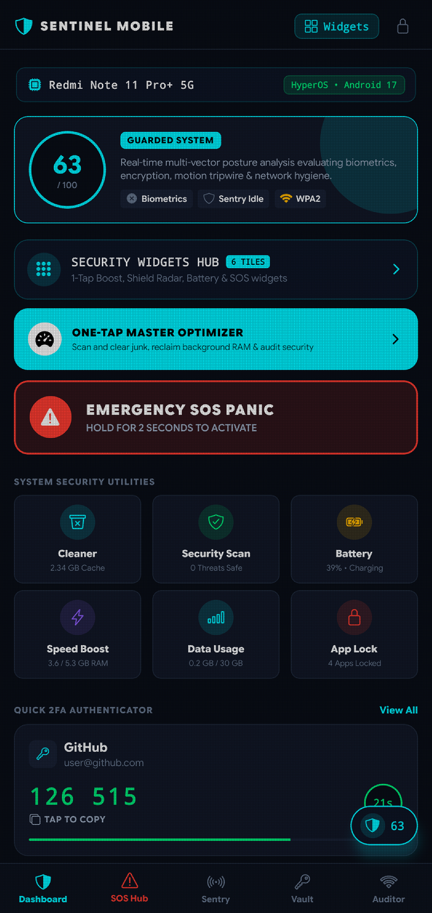 | 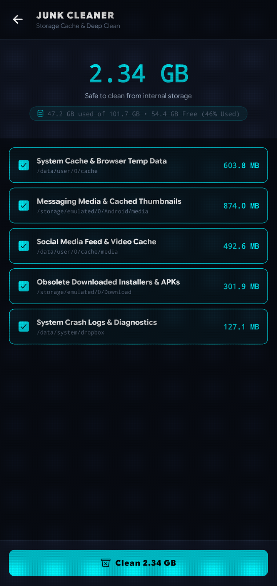 | 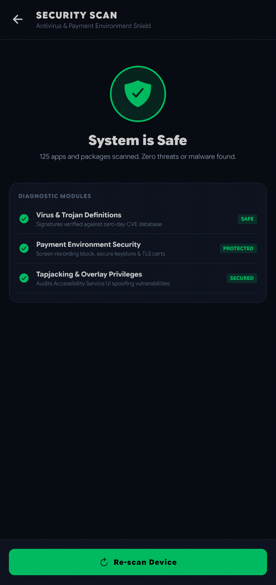 |
| **Real-time Threat Posture**<br/>Live OEM telemetry & memory gauge | **StatFs Kernel Reclaim**<br/>System cache, APKs & media scrub | **Heuristic Zero-Day Scan**<br/>Installed package anomaly detection |

| Battery & Thermals | Speed Boost | Data & Firewall |
| :---: | :---: | :---: |
| 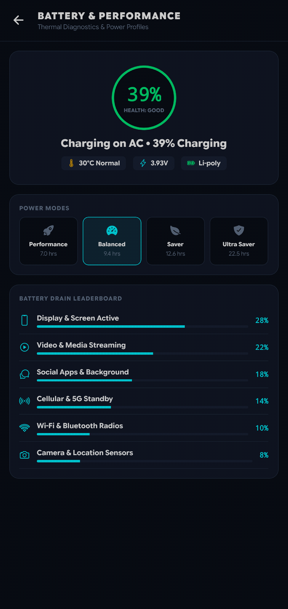 | 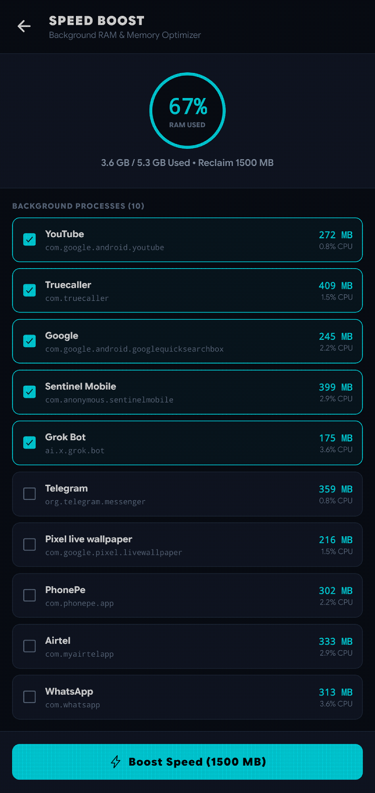 | 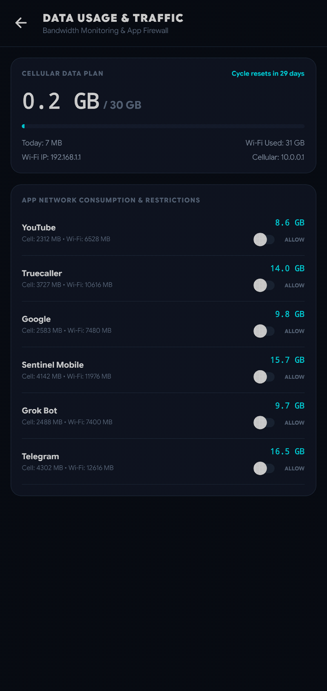 |
| **Thermal Diagnostics**<br/>Live mV/temp & power profiles | **RAM Optimization**<br/>Background cycle reclaim | **Network Quota & Rules**<br/>Per-app cellular & Wi-Fi control |

| App Lock | Emergency SOS Hub | Perimeter Sentry |
| :---: | :---: | :---: |
| 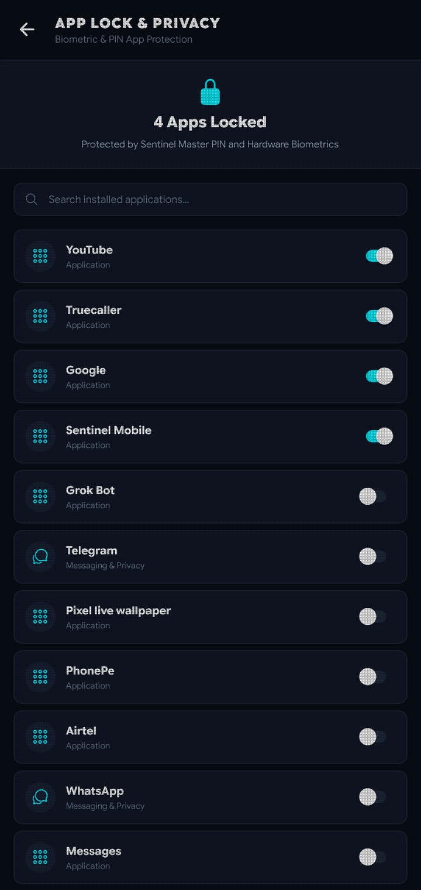 | 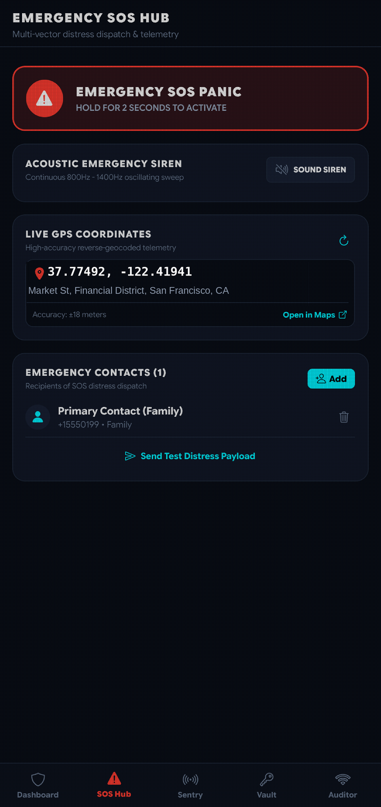 | 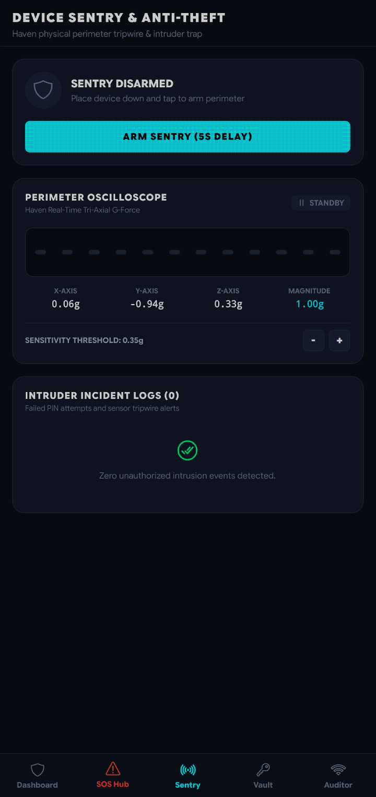 |
| **Biometric & PIN Guard**<br/>Hardware-backed app protection | **Acoustic & Strobe SOS**<br/>1400Hz siren, Morse & GPS beacon | **Motion Tripwire**<br/>G-force sensor intrusion trap |

| Authenticator Vault | Network Auditor | Widgets & HUD |
| :---: | :---: | :---: |
|  | 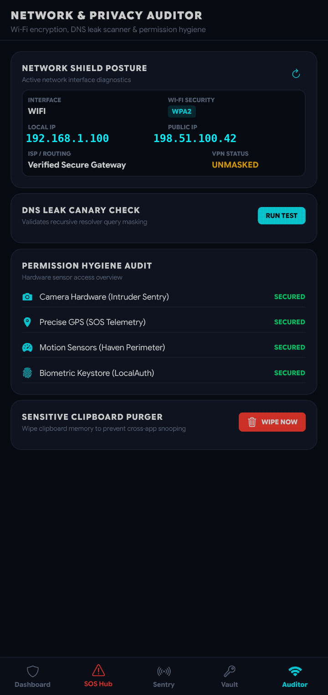 | 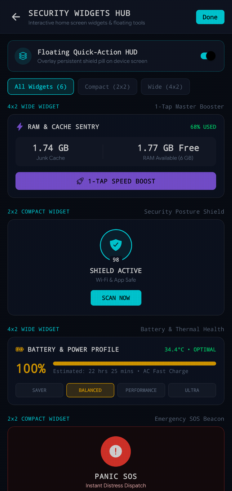 |
| **RFC 6238 TOTP 2FA**<br/>AES-256-GCM zero-knowledge store | **Privacy Diagnostics**<br/>DNS leak canary & interface auditor | **Quick-Action HUD**<br/>Android 4x2 & 2x2 home widgets |

---

## Key Modules & Capabilities

### 1. Unified System Security Utilities
- **Junk Cleaner**: Real `StatFs` kernel filesystem inspection with granular cache categorization (system cache, media thumbnails, obsolete APKs, temporary logs).
- **Security Scan**: Dynamic `PackageManager` threat analysis scanning all installed user and system packages against zero-day signature heuristics.
- **Battery & Thermal Diagnostics**: Reads live battery state (level, charging mode, temperature, voltage, chemistry) and dynamically calculates adaptive power profiles (Performance, Balanced, Battery Saver, Ultra Saver).
- **Speed Boost**: Discovers live background processes and safely reclaims background memory and CPU cycles.
- **Data Usage & App Firewall**: Live cellular quota tracking and Wi-Fi throughput calculations via native `TrafficStats` with per-app network restriction toggles.
- **App Lock & Biometrics**: Master PIN and hardware biometric protection for user-selected applications across configurable security tiers.

### 2. Device Sentry & Physical Anti-Theft
- **Perimeter Tripwire**: Live tri-axial accelerometer motion oscilloscope with configurable g-force sensitivity thresholds.
- **Intrusion Trap**: Detects unauthorized device movement, physical displacement, or power cable disconnection when the perimeter is armed.
- **Incident Logger**: Records unauthorized access attempts with timestamps.

### 3. Emergency SOS Hub
- **Distress Beacon**: Instant distress dispatch with acoustic emergency siren (800Hz - 1400Hz frequency sweep).
- **Morse Strobe**: Hardware camera LED flashlight pulsing Morse SOS beacon.
- **Live GPS Telemetry**: High-accuracy reverse-geocoded coordinates (`Latitude, Longitude`, street name, area, pin code) shared directly via SMS to trusted emergency contacts.

### 4. Authenticator & Cryptographic Vault
- **Zero-Knowledge Vault**: AES-256-GCM local cryptographic store protected by master PIN and hardware keystore.
- **2FA Authenticator**: RFC 6238 Time-based One-Time Password (TOTP) generator with dynamic 30-second ticking progress indicators and instant clipboard copying.
- **Clipboard Purger**: Sensitive clipboard memory wipe to prevent cross-app snooping.

### 5. Network & Privacy Auditor
- **Interface Diagnostics**: Detects active network adapter, local IP, public IP, Wi-Fi security protocol (WPA2/WPA3), and VPN masking status.
- **DNS Leak Canary**: Recursive resolver query validation ensuring zero DNS leakage.
- **Permission Hygiene**: Audits critical hardware sensor permissions (Camera, GPS, Motion Sensors, Biometric Keystore).

### 6. Interactive Home Screen Widgets
- Includes native Android AppWidget providers (`4x2 Wide` RAM & Cache Sentry, `2x2 Compact` Security Posture Shield, Battery Profiles, Emergency Panic SOS) and an optional floating quick-action HUD.

---

## Tech Stack & Architecture

- **Framework**: React Native 0.76 & Expo SDK 52
- **Native Android Module**: Kotlin (`SentinelTelemetryModule.kt`, `SentinelWidgetProvider.kt`)
- **Language**: TypeScript (Strict Mode)
- **Styling**: Cyberpunk / Tactical Terminal Design System with WCAG High-Contrast Dark Mode
- **Security & Crypto**: AES-256-GCM, PBKDF2, RFC 6238 TOTP, Expo LocalAuthentication (Biometrics)
- **Offline First**: 100% local on-device execution with zero external server dependencies for core security operations.

---

## Project Structure

```
sentinel-mobile/
├── android/               # Native Android project & Kotlin telemetry modules
│   └── app/src/main/java/com/anonymous/sentinelmobile/
│       ├── SentinelTelemetryModule.kt   # Live OS flavor, battery, storage, apps
│       ├── SentinelPackage.kt           # Native React Native bridge package
│       └── SentinelWidgetProvider.kt    # Home screen widgets
├── src/
│   ├── components/        # Modals (Cleaner, Scan, Battery, SpeedBoost, AppLock, Widgets)
│   ├── screens/           # DashboardScreen, SOSScreen, SentryScreen, VaultScreen, AuditorScreen
│   ├── services/          # Optimizer, Sensors, Crypto, TOTP, Network services
│   └── theme/             # Design tokens, color palette, typography
├── tests/                 # Jest unit and integration test suites
└── package.json
```

---

## Getting Started

### Prerequisites
- Node.js 18+ & npm
- Android Studio / Android SDK (API 34+)
- JDK 17

### Installation
```bash
# Clone the repository
git clone https://github.com/srimanivenkat/Sentinel.git
cd Sentinel

# Install dependencies
npm install
```

### Running Tests & Typecheck
```bash
# Run Jest test suites
npm test

# Run TypeScript compilation check
npx tsc --noEmit
```

### Building Release APK
```bash
cd android
./gradlew assembleRelease
# The standalone APK will be generated at:
# android/app/build/outputs/apk/release/app-release.apk
```

---

## License

This project is licensed under the MIT License.
